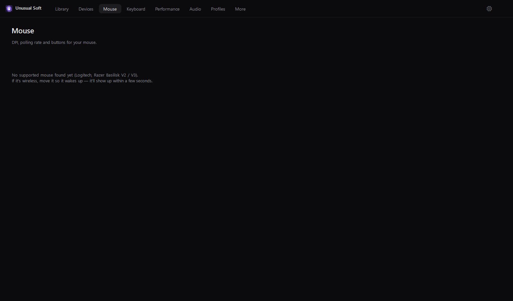
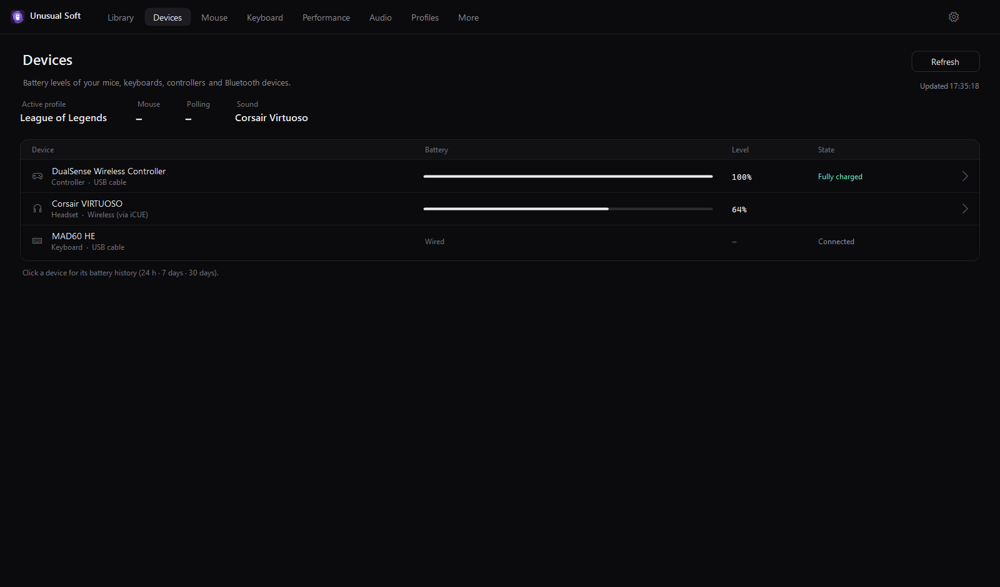
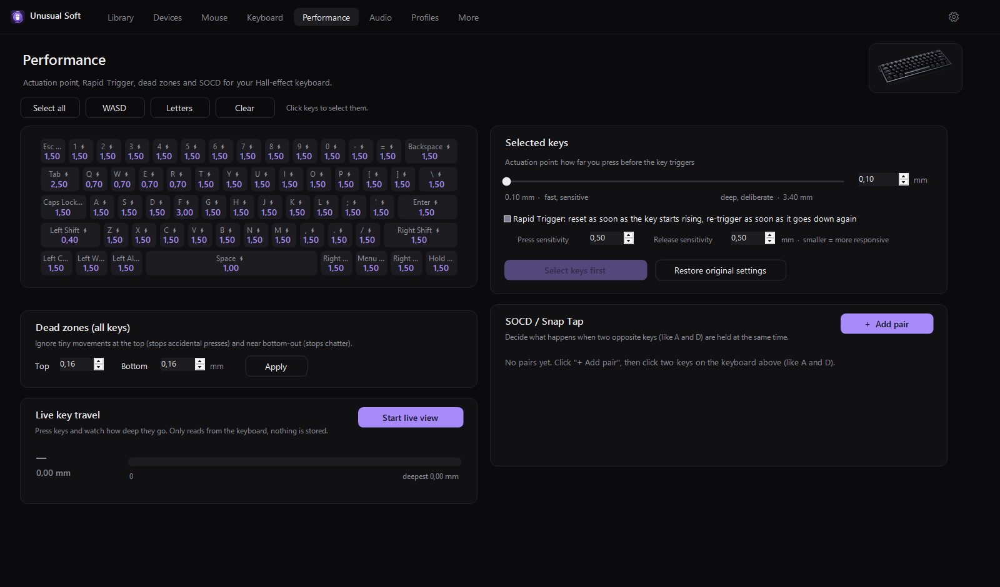
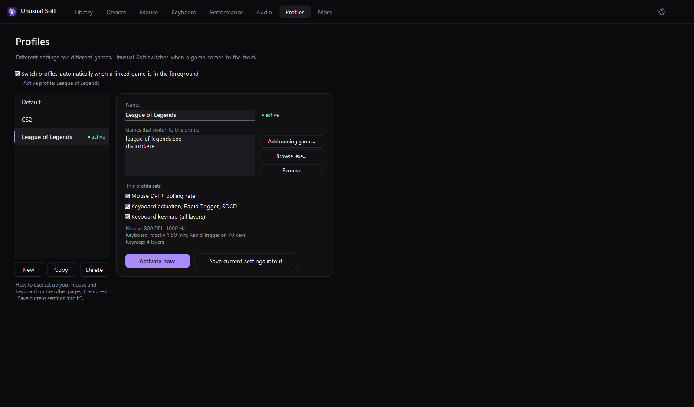
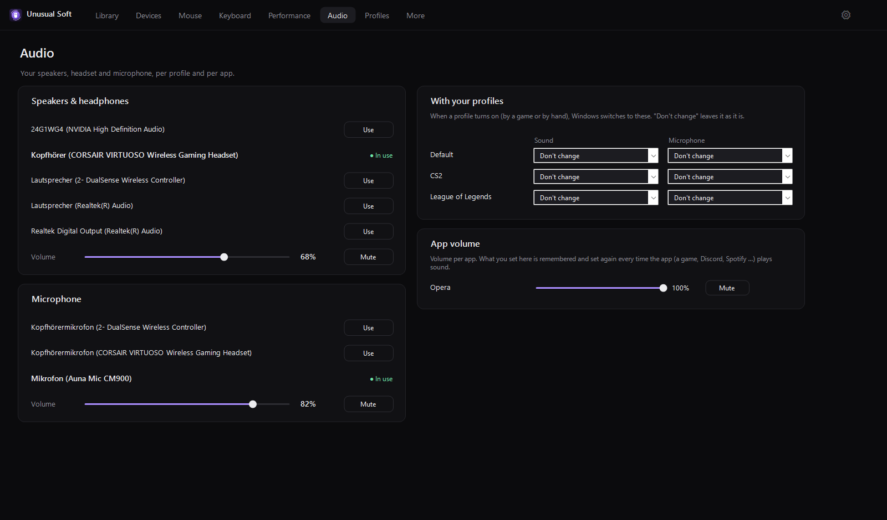
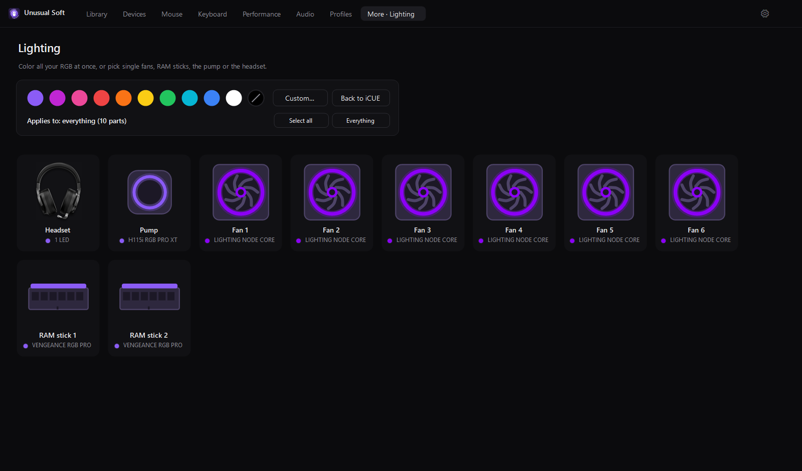
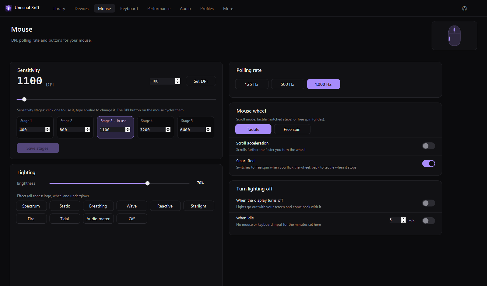
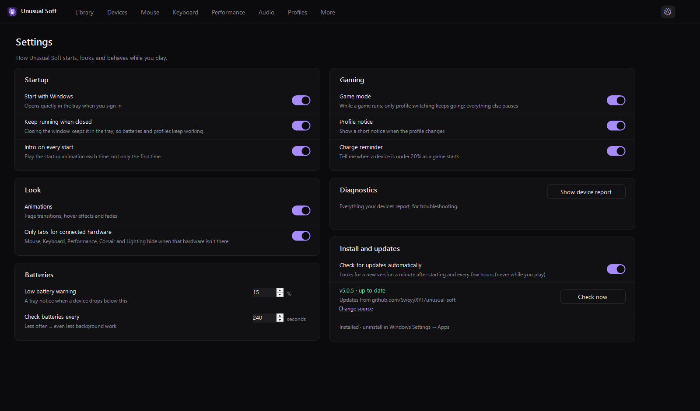

# Unusual Soft

**Your mouse, keyboard, headset and games in one small, fast app for Windows.**

Battery levels, DPI and buttons, Hall-effect keyboard tuning, RGB lighting, per-game profiles, audio and a game library,
without G HUB, Synapse or five other launchers running in the background.

[**⬇ Download the latest version**](https://github.com/SweyyXYT/unusual-soft/releases/latest)

---

## Features

### 🖱️ Mouse
Map every button on a photo of your mouse (clicks, DPI up/down, sniper, media keys, any key combination). Set the five DPI stages on one slider, the polling rate and onboard / software mode. Everything is stored **on the mouse**, so it works in every game even without Unusual Soft running.

### 🔋 Devices and batteries
All your devices in one list: battery level, charging state, time left, and a battery history for 24 h, 7 days and 30 days. A tray warning when something gets low, and a reminder when you start a game with a nearly empty mouse.

### ⌨️ Keyboard and Hall-effect performance
Remap any key on every layer (any QMK / VIA keyboard). On Hall-effect keyboards: actuation point per key (0.1–3.4 mm), **Rapid Trigger**, dead zones, **SOCD / Snap Tap** pairs (click "+ Add pair", then the two keys) and a **live key-travel** view.

### 🎮 Game library and profiles
All installed games from Steam, Epic, Riot, Battle.net, EA, Ubisoft and GOG as covers. Click to play.
- **Profiles** switch DPI, keyboard settings and sound device automatically when a game comes to the front.
- **Open with this game:** apps like Blitz start with the game and close again after it.
- **While playing:** best-performance power plan, Windows "do not disturb", and apps you choose get closed. All of it goes back afterwards.
- **League of Legends** starts straight into the client. The Riot Client hides while you play and quits afterwards.

### 🔊 Audio
Pick speakers, headset and microphone, set volumes, let each profile switch them, and set a **volume per app** (games, Discord, Spotify …) that's remembered.

### 🌈 Corsair and lighting
Headset (battery, mic, sidetone), cooler temperature and fan speeds, RAM and fans through Corsair's official iCUE SDK. One palette colors all RGB at once, or click single fans, RAM sticks or the pump.

### 🐍 Razer mice (Basilisk V2 / V3)
DPI and the five sensitivity stages, polling rate, the V3's free-spin wheel (scroll acceleration, Smart Reel) and lighting: spectrum, static, breathing, wave, reactive, starlight, fire, tidal and audio meter, with one color, two colors or random. The lighting can also turn off when you're idle or when the screen goes off.

### 💾 Backup, settings and updates
Back up everything (profiles, library, saved original keymaps) in one click, automatically every week, and restore it any time. Unusual Soft updates itself from this page.

---

## Supported hardware

| | Works with |
|---|---|
| **Mice** | Logitech (HID++ 2.0: LIGHTSPEED, Unifying, Bolt, USB, e.g. G502 X) · Razer Basilisk V2 / V3 |
| **Keyboards** | Any QMK / VIA keyboard (layout from its VIA file) · Madlions MAD60 HE (Hall-effect) |
| **Headsets** | Corsair (via iCUE) · Logitech |
| **Controllers** | PlayStation DualSense / DualSense Edge / DS4 · Xbox (XInput) |
| **RGB** | Corsair iCUE devices (fans, Lighting Node, RAM, coolers) |
| **Detected** | Mice and keyboards from Razer, Roccat, SteelSeries, HyperX, ASUS ROG, Zowie, Keychron and Cherry (shown on the Devices page) |

Tabs only appear for hardware you actually have.

---

## Install

1. Download **Unusual Soft.exe** from the [latest release](https://github.com/SweyyXYT/unusual-soft/releases/latest).
2. Start it. If Windows shows "Windows protected your PC", click **More info → Run anyway** (the app isn't code-signed).
3. Click **Yes** when it asks to install.

No admin rights, nothing else to install. It goes to your user folder, adds Start-menu and desktop shortcuts, and starts with Windows (you can turn that off).

**Updates** install themselves: Unusual Soft checks this page every few hours (never while you play) and asks before installing.
**Uninstall:** Windows Settings → Apps → Unusual Soft.

Requirements: Windows 10 or 11 (64-bit). For Corsair devices, iCUE has to be running with its SDK option turned on.

---

## Safe to use with anti-cheat

Unusual Soft never touches a game:
- It talks only to your devices over USB, and to Windows' own settings.
- It never opens, reads or injects into a game process. It only asks Windows which window is in front.
- It has no overlay, no input hook and no macros.
- Mouse and keyboard settings are stored on the devices themselves, the same way their official apps do it.

## FAQ

**Do I still need G HUB / Synapse / iCUE?**
G HUB and Synapse: no. Close them, otherwise they overwrite your settings. iCUE: keep it running for Corsair devices (Unusual Soft uses its official SDK).

**Will my settings survive an update?**
Yes. Settings, profiles and the library are stored separately from the program and are never touched by updates.

**Something doesn't work with my device.**
Open an [issue](https://github.com/SweyyXYT/unusual-soft/issues) with the device name and a screenshot. Settings → Diagnostics → *Show device report* helps a lot.
